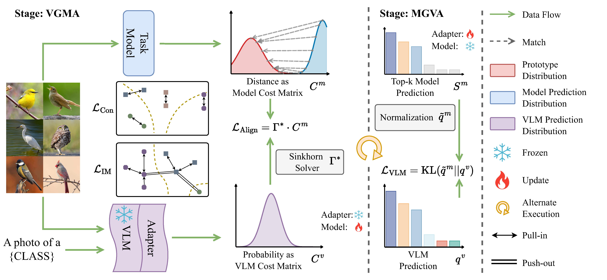

## Vision-Language Model Guided Source-Free Domain Adaptation via Optimal Transport

> ### 本仓库使用说明（复现版）
>
> 所有命令都在**项目根目录**下运行（Jupyter 里在前面加 `!`）。
>
> | 步骤 | 命令 | 说明 |
> |---|---|---|
> | 1. 数据软链接（只需一次） | `bash scripts/link_data.sh` | 把云端数据链接到 `dataset/OfficeHomeDataset/`，含 `classname.txt` |
> | 2. 训练源模型 + 12 个任务 | `bash scripts/run.sh` | 正式训练，结果在 `runs/Source_home/`、`runs/OfficeHome/` |
> | 3. OT 消融 | `bash scripts/run_ablation.sh` | 结果打包到 `runs/ablation_results/<日期>.zip` |
> | 4. 近邻平滑实验 | `bash scripts/run_knn.sh` | `--knn_k` / `--knn_mgva`，和消融基线一起汇总到 `runs/ablation_results/<日期>.zip` |
> | 5. 强视图对齐实验 | `bash scripts/run_strong.sh` | `--align_view strong/both`（Noisy Student），和消融基线一起汇总 |
> | 6. 训练动态诊断 | `bash scripts/run_dynamics.sh` | `--log_dynamics`：每个 epoch 记录老师准确率、一致率、翻转率、伪标签准确率等，汇总表末尾附动态表 |
> | 7. 共识塌缩实验 | `bash scripts/run_collapse.sh` | `--log_samples`（逐样本预测）、`--freeze_teacher_at`（冻结老师）、`--knn_self_after`（近邻平滑混入学生概率）、`--adaptercount 12`；另附 `collapse.md` 状态转移分析 |
> | 诊断：分歧裁决 | `bash scripts/run_arbitration.sh` | 不训练；读取上一行保存的 `samples.npz`，检验无标签信号能否在师生分歧时分辨谁对；结果打包到 `runs/arbitration_results/<日期>.zip` |
> | 诊断：交叉点检测 | `bash scripts/run_crossover.sh` | 不训练；读取同样的 `samples.npz`，检验不用标签能否判断当前阶段学生和老师谁更准、估出的交叉点离真实值多远；汇总打印在「汇总开始 / 汇总结束」之间 |
> | 8. 表示诊断 | `bash scripts/run_repr.sh` | 训练一次 ot_knn10_both 并存 5 个快照（不开诊断记录），`tools/diag_repr.py` 比较各层的有效秩、线性探针、近邻标签准确率（普通 / 互近邻 / CSLS）和无标签近邻信号；全部结果打印在「汇总开始 / 汇总结束」之间 |
> | 诊断：无标签重拟合分类头 | `bash scripts/run_head.sh` | 不训练网络；用上一行的快照，在冻结特征上用学生 / 老师 / 一致样本 / 高置信样本作标签重拟合线性头，看能拿回探针（85）和学生（76）之间多少；结果打印在「汇总开始 / 汇总结束」之间 |
> | 诊断：锁死错误结构 | `bash scripts/run_locked.sh` | 不训练；用表示诊断的快照，描述锁死错误的类对集中度、吞并类、真实类在概率中的名次、子簇；结果打印在「汇总开始 / 汇总结束」之间 |
> | 诊断：类边际纠正 | `bash scripts/run_marginal.sh` | 不训练；用表示诊断的快照，在全数据集上按不同类边际（预测 / 平均概率 / 收缩 / 均匀 / 真实上界）用 Sinkhorn 重新分配；结果打印在「汇总开始 / 汇总结束」之间 |
> | 9. 对齐权重曲线 | `bash scripts/run_weight.sh` | `--align_weight const / cap`（`--align_cap`）：对齐权重一直为 1，或交叉点后保持 0.2；底座 ot_knn10_both；结果打印在「汇总开始 / 汇总结束」之间 |
> | 10. 对齐权重上限验证 | `bash scripts/run_cap.sh` | cap02 在 Pr→Cl / Re→Cl 的泛化、cap 0.1 / 0.3 / 0.5 扫描、Ar→Cl 上 cap02 与底座各 2 个额外种子；结果打印在「汇总开始 / 汇总结束」之间 |
> | 11. 消融 + 全部 12 个任务 | `bash scripts/run_officehome.sh` | cap 0 / 0.05 消融、cap02 的训练动态（锁死 / 并集）、Office-Home 12 个任务 × {底座, cap02}；结果打印在「汇总开始 / 汇总结束」之间 |
> | 12. cap02 多种子 | `bash scripts/run_seeds.sh` | 12 个任务 × cap02 × seed 0、1（底座的多种子可取消注释）；结果打印在「汇总开始 / 汇总结束」之间，含跨任务平均表 |
> | 13. 冻结源模型专家 | `bash scripts/run_src.sh` | `--src_expert`（`--src_expert_until`）：对齐目标的 CLIP 概率换成 CLIP × 冻结源模型（按熵加权）；在 Cl→Ar、Re→Ar、Ar→Pr、Ar→Cl 上和 cap02 对照；汇总含跨任务对照和 COSMO 参照 |
> | 诊断：Art 目标 | `bash scripts/run_art.sh` | Cl→Ar、Re→Ar 的 cap02 和 Cl→Ar 底座，都开训练动态记录和快照；自动做共识塌缩、表示诊断、锁死结构；结果打印在「汇总开始 / 汇总结束」之间 |
> | 14. 后期减弱 MGVA | `bash scripts/run_vil.sh` | `--vil_after P --vil_low c`：到进度 P 后老师 adapter 学习率 × c；在 Cl→Ar、Re→Ar、Ar→Cl、Ar→Pr 上和 cap02 对照 |
> | 15. 组件审计 | `bash scripts/run_audit.sh` | 在 cap02 上逐项去掉 IM 熵项 / 类频率重加权 / IM diversity / SimSiam / MGVA、分类头学习率 ×10；4 个任务 × 6 组约 9 小时；`SUMMARY_ONLY=1` 只汇总 |
> | 16. 老师侧学习信号 | `bash scripts/run_teacher.sh` | 在 cap02 上：`--t_ema`（老师学学生概率的动量平均）/ `--t_strong`（老师也学强增强视图）/ `--t_im 1`（老师加自身 IM）；`--clsw_mode const / sqrt`（量级匹配的类频率重加权消融）；4 个任务 × 5 组约 7.5 小时 |
> | 17. H1：CLIP 表示的上限 | `bash scripts/run_h1.sh` | 12 个任务训练前快照（只初始化）+ cap02 训练结束快照，线性探针比较原始 CLIP / 源模型 / 训练后学生；约 2.5–3 小时 |
> | 18. 类原型修正（离线） | `bash scripts/run_proto.sh` | 需要先跑 run_h1.sh；在快照的 CLIP 特征上从文本原型出发做无标签原型修正，对比老师 / 探针 / COSMO；约 30 分钟，不训练 |
> | 19. Ar→Pr 上的两个改动 | `bash scripts/run_ab.sh` | `--clsw_mode prior`（类均衡推向 CLIP 零样本平均概率）/ `--t_proto`（老师类原型可学习）；先检查 μ̂ 的前提；2 组约 50 分钟 |
> | 20. 第 1 步：可学习提示上下文 | `bash scripts/run_prompt.sh` | `--t_prompt`（老师文本端 4 个共享上下文向量，"a photo of a" 初始化）/ `--no_adapter`；Ar→Pr，含训练动态；约 2.2 小时 |
> | 诊断：训练快照 + OT 指标 | `bash scripts/run_diag.sh` | 结果打包到 `runs/diag_results/<日期>.zip` |
> | 诊断：μ_p 消融等 | `bash scripts/run_diag_quick.sh` | 需要先跑上一行的快照 |
> | 诊断：μ_p 估计器对比 | `bash scripts/run_diag_mu.sh` | 需要先跑 `run_diag.sh` 的快照；结果打包到 `runs/diag_mu_results/<日期>.zip` |
> | 诊断：全数据集 OT | `bash scripts/run_diag_global.sh` | 需要先跑 `run_diag.sh` 的快照；结果打包到 `runs/diag_global_results/<日期>.zip` |
> | 诊断：目标域结构 | `bash scripts/run_diag_struct.sh` | 需要先跑 `run_diag.sh` 的快照；结果打包到 `runs/diag_struct_results/<日期>.zip` |
> | 诊断：GLC 式全局聚类 | `bash scripts/run_diag_glc.sh` | 需要先跑 `run_diag.sh` 的快照；结果打包到 `runs/diag_glc_results/<日期>.zip` |
> | 诊断：簇级命名（方案 A） | `bash scripts/run_diag_cluster.sh` | 需要先跑 `run_diag.sh` 的快照；结果打包到 `runs/diag_cluster_results/<日期>.zip` |
> | 检查 CLIP 零样本准确率 | `python tools/zeroshot_clip.py` | 应为平均 79.04%（论文表 4） |
>
> - `scripts/`：运行脚本，配置都写在每个脚本开头，有注释。`tools/`：被脚本调用的汇总 / 诊断程序。
> - **所有输出都在 `runs/` 下**：训练产物 `runs/`，结果压缩包 `runs/<名称>_results/`，日志 `runs/logs/`。根目录只放代码。
> - 和公开代码的区别：Office-Home 类名改为从 `classname.txt` 读取（原写死的类名在第 58–63 类和标签错位）；
>   `main.py` 新增 `--align_mode`（OT 消融）、`--knn_k` / `--knn_mgva`（学生特征空间近邻平滑，默认关闭）、`--align_view`（强视图对齐，默认 weak）、`--log_dynamics`（训练动态记录，默认关闭）、`--log_samples` / `--freeze_teacher_at` / `--knn_self_after`（共识塌缩实验，默认关闭）、`--snapshot_at` / `--stop_at`（诊断快照）、进度条和训练计时。
>   训练公式和超参与公开代码完全一致。修复类名后 Ar→Cl = 74.4%（论文 75.0%）。
> - 下方原 README 中 `--name Source\Source_art` 的反斜杠在 Linux 下会被吞掉，请用 `scripts/run.sh`，
>   它会按 `Source_home/Source_<域>` 命名（realworld 为 `Source_real world`）。
> - 实验记录在本地 `archive/`（不提交）。

### Abstract

Unsupervised domain adaptation transfers knowledge from a labeled source domain to an unlabeled target domain. When source data cannot be accessed, source-free domain adaptation (SFDA) becomes a practical alternative. However, existing SFDA methods mainly rely on pseudo-label based self-training, which often accumulates noise and bias under large domain gaps. We propose VSFOT, a framework that leverages a pretrained Vision-Language Model (VLM) to guide optimal transport (OT) alignment between target features and source prototypes. Instead of relying on unreliable pseudo-labels, VSFOT employs VLM-derived semantic priors and an OT-based matching strategy to achieve stable and reliable adaptation. To further enhance domain alignment, VSFOT incorporates a bidirectional distillation mechanism in which the model learns semantic consistency from the VLM, while the VLM is refined using task-specific cues from the model. These two stages alternate during training. By combining the generalization ability of the VLM with the discriminative power of the task model, VSFOT achieves robust, source-free adaptation and consistently outperforms existing SFDA methods on four benchmark datasets.


### Framework




### Environment

The code is tested with Python 3.x and PyTorch. Install the dependencies with: `pip install -r requirements.txt`


### Dataset

This project supports the following datasets:

| Dataset argument | Domains |
| --- | --- |
| `OFFICE31` | `amazon`, `dslr`, `webcam` |
| `OfficeHomeDataset` | `art`, `clipart`, `product`, `realworld` |
| `VisDA` | `synthesis`, `real` |
| `DomainNet-126` | `clipart`, `painting`, `real`, `sketch` |

The repository provides image-list files under `dataset/<dataset_name>/*.txt`.

Before running the code, modify `IMAGEFILE` at the beginning of both `main.py` and `trainsSurce.py` to the root path of the raw datasets. Make sure the raw image folders under `IMAGEFILE` match the paths recorded in the corresponding `.txt` files under `dataset/`.

Default paths in the code: `IMAGEFILE = "/root/user/dataset"`


### Usage

The training procedure has two stages:

1. Train the source model with labeled source-domain data.
2. Run source-free adaptation on the unlabeled target-domain data.

**1. Train Source Model**
```bash
python trainSource.py --name Source\Source_realworld --dataset OfficeHomeDataset --source realworld
python trainSource.py --name Source\Source_product --dataset OfficeHomeDataset --source product
python trainSource.py --name Source\Source_clipart --dataset OfficeHomeDataset --source clipart
python trainSource.py --name Source\Source_art --dataset OfficeHomeDataset --source art
```

The source checkpoint will be saved as: `runs/Source/Source_<domain>/Source.pt`


**2. Adapt to Target Domain**

```bash
python main.py --device 0 --name OfficeHome/Ar2Cl --epochs 40 --dataset OfficeHomeDataset --source art --target clipart
python main.py --device 0 --name OfficeHome/Ar2Pr --epochs 40 --dataset OfficeHomeDataset --source art --target product
python main.py --device 0 --name OfficeHome/Ar2Re --epochs 40 --dataset OfficeHomeDataset --source art --target realworld
python main.py --device 0 --name OfficeHome/Cl2Ar --epochs 40 --dataset OfficeHomeDataset --source clipart --target art
python main.py --device 0 --name OfficeHome/Cl2Pr --epochs 40 --dataset OfficeHomeDataset --source clipart --target product
python main.py --device 0 --name OfficeHome/Cl2Re --epochs 40 --dataset OfficeHomeDataset --source clipart --target realworld
python main.py --device 0 --name OfficeHome/Pr2Ar --epochs 40 --dataset OfficeHomeDataset --source product --target art
python main.py --device 0 --name OfficeHome/Re2Ar --epochs 40 --dataset OfficeHomeDataset --source realworld --target art
python main.py --device 0 --name OfficeHome/Pr2Cl --epochs 40 --dataset OfficeHomeDataset --source product --target clipart
python main.py --device 0 --name OfficeHome/Pr2Re --epochs 40 --dataset OfficeHomeDataset --source product --target realworld
python main.py --device 0 --name OfficeHome/Re2Cl --epochs 40 --dataset OfficeHomeDataset --source realworld --target clipart
python main.py --device 0 --name OfficeHome/Re2Pr --epochs 40 --dataset OfficeHomeDataset --source realworld --target product

```

Outputs, logs, checkpoints, and copied code snapshots are saved under: `runs/<experiment_name>/`


### Additional Note

1. For weight information and validation details, please refer to the `model` branch.

2. Email: sureshan@foxmail.com
